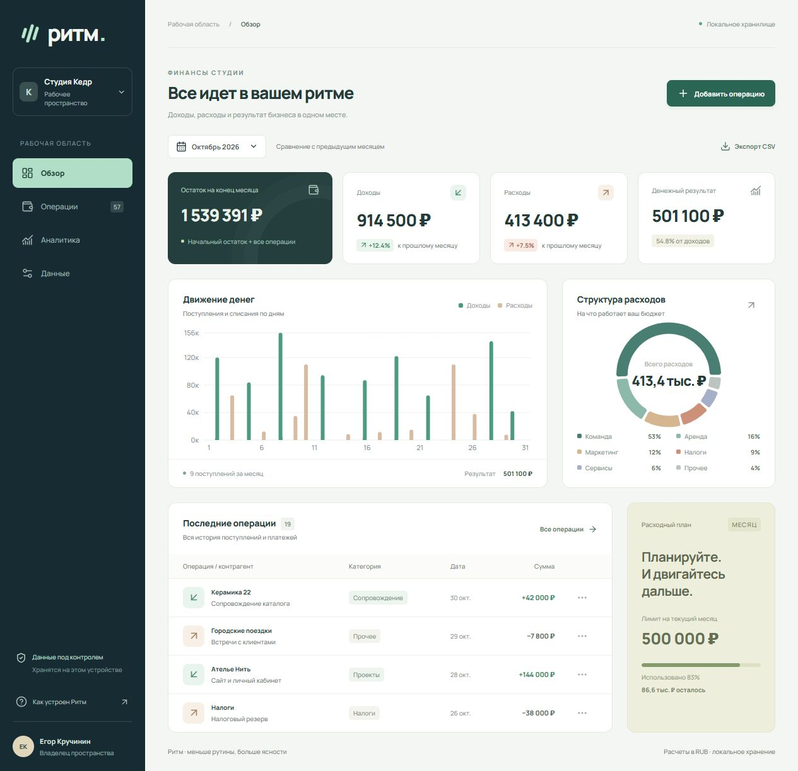
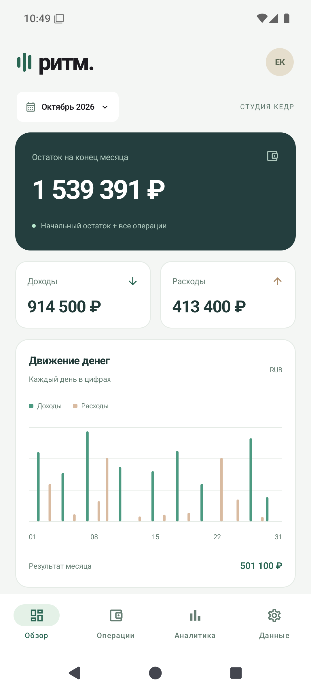
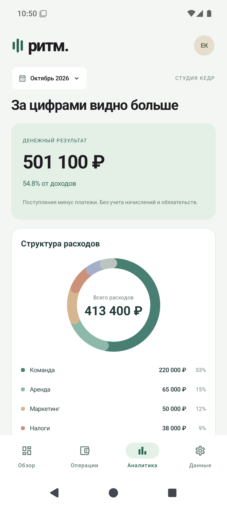
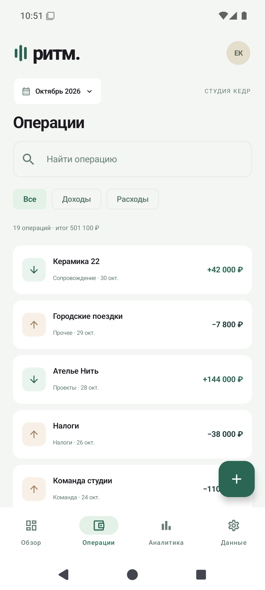
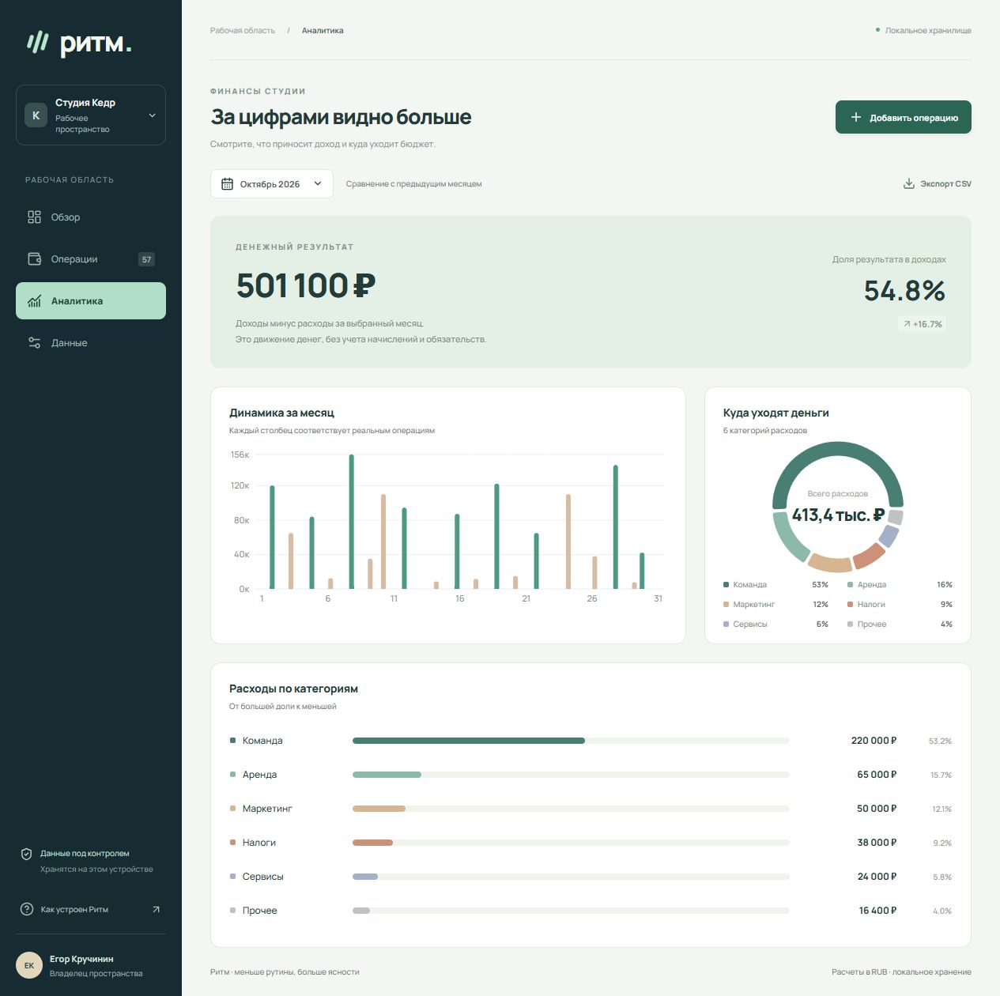
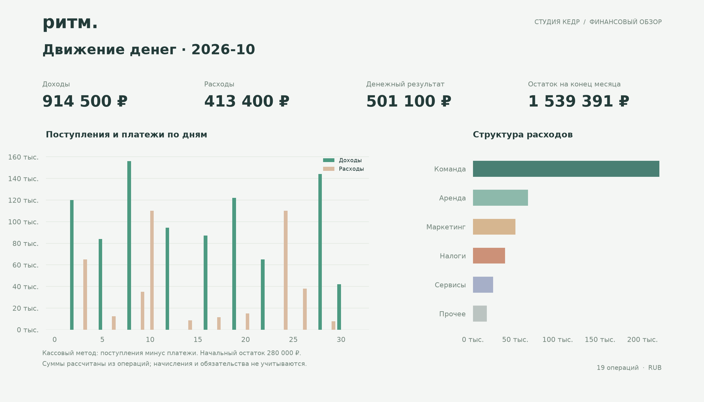

# Ритм

**Доходы, расходы и ясная картина небольшого бизнеса.**

Ритм помогает понять, сколько заработала студия за месяц, на что ушли деньги и какой остаток доступен. Операции можно добавить с телефона, посмотреть в журнале, перенести в веб-версию и собрать отдельный отчет.

В репозитории находятся два самостоятельных приложения: нативное Android на Kotlin и веб-интерфейс на React. Они используют одинаковую модель операций и формат CSV. Python-модуль строит отчеты из тех же данных.

Это самостоятельный проект для портфолио. Студия, контрагенты и все операции вымышлены. Код и материалы из закрытых коммерческих проектов не используются.

## Посмотреть

- [Открыть веб-приложение](https://0taiga0.github.io/ritm-business-ledger/)
- [Скачать APK и посмотреть выпуск](https://github.com/0Taiga0/ritm-business-ledger/releases/latest)
- [Архитектура](docs/architecture.md) и [результаты проверки](docs/verification.md)



### Android

<p>
  
  
  
</p>

### Аналитика и отдельный отчет



Python-модуль собирает отчет без открытого браузера. Пример: [PDF за октябрь](docs/reports/ritm-2026-10.pdf), [сводные показатели JSON](docs/reports/ritm-2026-10.json).



## Что работает

- Обзор остатка, поступлений, расходов и денежного результата за месяц.
- График движения денег по дням и распределение расходов по категориям.
- Создание, редактирование и удаление операций с проверкой суммы и даты.
- Журнал с поиском и фильтрами, переключение месяцев.
- Локальное сохранение после закрытия и повторного запуска.
- Экспорт и импорт CSV. Повторный импорт не создает дубли с тем же ID.
- Отдельный отчет Python: PNG, PDF и JSON со сводными показателями.

## Технологии

| Часть | Реализация |
| --- | --- |
| Android | Kotlin, Jetpack Compose, Material 3, Room, Coroutines, StateFlow |
| Web | React, TypeScript, Vite, Recharts, HTML dialog, localStorage |
| Отчеты | Python, pandas, matplotlib |
| Проверки | JUnit, Vitest, pytest, ручные сценарии интерфейсов |

### Несколько решений в коде

Деньги хранятся целыми копейками. В расчетах не накапливается ошибка двоичной дроби. Остаток учитывает только операции до конца выбранного месяца, поэтому будущий платеж не меняет прошлый отчет.

Денежный результат считается кассовым методом: поступления минус платежи. Он не выдается за бухгалтерскую прибыль. При нулевом доходе приложение показывает отсутствие базы для расчета доли, а не бесконечный процент.

Android разделен на экран, ViewModel, репозиторий и базу Room. Начальное заполнение выполняется один раз в транзакции. Если удалить все записи, они не появятся заново после следующего запуска.

Импорт проверяет типы, даты, категории, размер файла и ID до сохранения. При экспорте экранируются значения, которые таблицы могут принять за формулы. Web и Android не обмениваются данными автоматически: перенос выполняется через CSV.

## Запуск Web

Требуется Node.js 20.19+ или 22 LTS.

```sh
cd web
npm ci
npm run dev
```

```sh
npm test
npm run build
npm run preview
```

## Сборка Android

Требуются JDK 17, Android SDK 35 и Build Tools 35.0.0. Можно открыть папку `android` в Android Studio либо задать `ANDROID_HOME` и выполнить:

```sh
cd android
./gradlew assembleDebug testDebugUnitTest
```

На Windows используйте `gradlew.bat`. Готовый APK появится в `android/app/build/outputs/apk/debug/app-debug.apk`. Минимальная версия Android: 8.0 (API 26).

## Отчет Python

Требуется Python 3.11+.

```sh
python -m venv .venv
# Активируйте окружение стандартным способом для своей ОС.
python -m pip install -e "./analytics[test]"
python -m pytest analytics/tests
ritm-report --input shared/seed.json --month 2026-10 --output reports
```

Вместо JSON можно передать CSV, выгруженный из любого приложения. Для правильного остатка используйте полную историю из раздела Данные. Выгрузка только за месяц подходит для анализа доходов и расходов, но не содержит предыдущих платежей:

```sh
ritm-report --input ritm-operations.csv --month 2026-10 --output reports
```

## Структура

```text
android/     Нативный клиент и модульные тесты
web/         Веб-клиент и тесты расчетов
analytics/   Воспроизводимые отчеты и их проверки
shared/      Общий набор операций и схема данных
scripts/     Генерация начальных данных
docs/        Скриншоты, отчеты, архитектура и результаты проверки
```

## Границы проекта

Приложения работают локально. В них нет авторизации, облачной синхронизации, банковских подключений и бухгалтерской отчетности. В Android отсутствует разрешение на доступ к интернету. Веб-приложению сеть нужна для первоначальной загрузки файлов, операции на сервер не отправляются.

Начальный остаток 280 000 руб. и расходный план 500 000 руб. заданы для примера студии. Очистка хранилища браузера или удаление Android-приложения удаляет локальные записи. Перед этим нужно экспортировать CSV.

Автор: Егор Кручинин.
